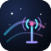

<p align="center">
  
</p>

<h1 align="center">Nebula</h1>

<p align="center">
  Aurora ambience, a clock-following sky, a deep-space theme, and Radio Garden radio — one package for the DeepSeek Harness Web UI.
</p>

## Features

- **Ambience** — a pointer-aware aurora and starfield across the whole frame. On by default.
- **Sky** — follows your local clock from dawn to night. Drag the Settings strip to preview any hour; **Live** returns to the clock.
- **Theme** — a deep-space palette for the whole app, with a lavender light variant, applied as a token skin.
- **Station** — five Radio Garden stations: Smooth Jazz 24/7 (default), Fox News Radio, FM Kahoku 78.8 FM, Ashiya Radio, and Listen Moe. Add and remove your own.

The composer sparkle is the **Follow the clock** switch. **Settings → General → Nebula Sky** also holds the theme and ambience switches. All three default on, with Dark as the default appearance.

## Install

### From Discover

Add this index source in **Plugins → Discover → Index sources**:

```
https://raw.githubusercontent.com/sudo-catz/dsh-nebula/main/market/index.json
```

### From npm

```
dsh-nebula
```

or pin the release:

```
dsh-nebula@1.1.0
```

### From Git

```
git+https://github.com/sudo-catz/dsh-nebula.git#c29d0f8ec5a7665bb448202ac891352e49b69bca
```

That commit is the `v1.1.0` release. Omit the `#…` to follow `main`.

### From a local checkout

```
link:/absolute/path/to/dsh-nebula
```

## Controls

| Action | Where |
| --- | --- |
| Follow the clock | Composer sparkle, or the Nebula Sky switch |
| Preview an hour | Drag the Nebula Sky strip (arrow keys, Home/End) |
| Return to live | **Live**, beside the sky status |
| Nebula theme / Ambience | Nebula Sky switches |
| Play / pause | Composer radio-tower icon or OS media keys |
| Stations, volume, Add station | Settings → General → Nebula Station |

## Good to know

- Client-only: no Host work, filesystem or network tools, dependencies, install scripts, or telemetry. Settings live in `localStorage`.
- The sky reads the device clock only; no geolocation.
- Radio Garden's listen endpoint is unofficial and intended for personal use.
- The five default stations are fixed; custom stations are yours to remove.
- Built for DSH Web 0.2.x. MIT © 2026 sudo-catz.
